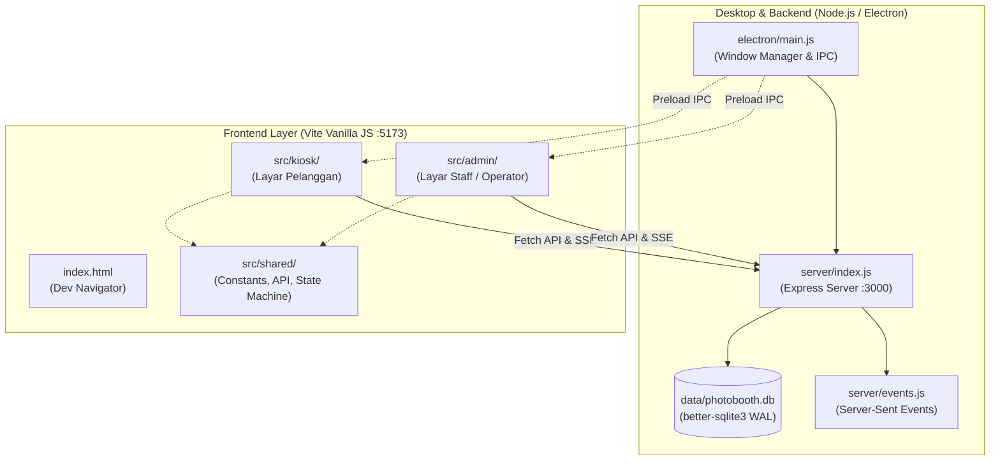
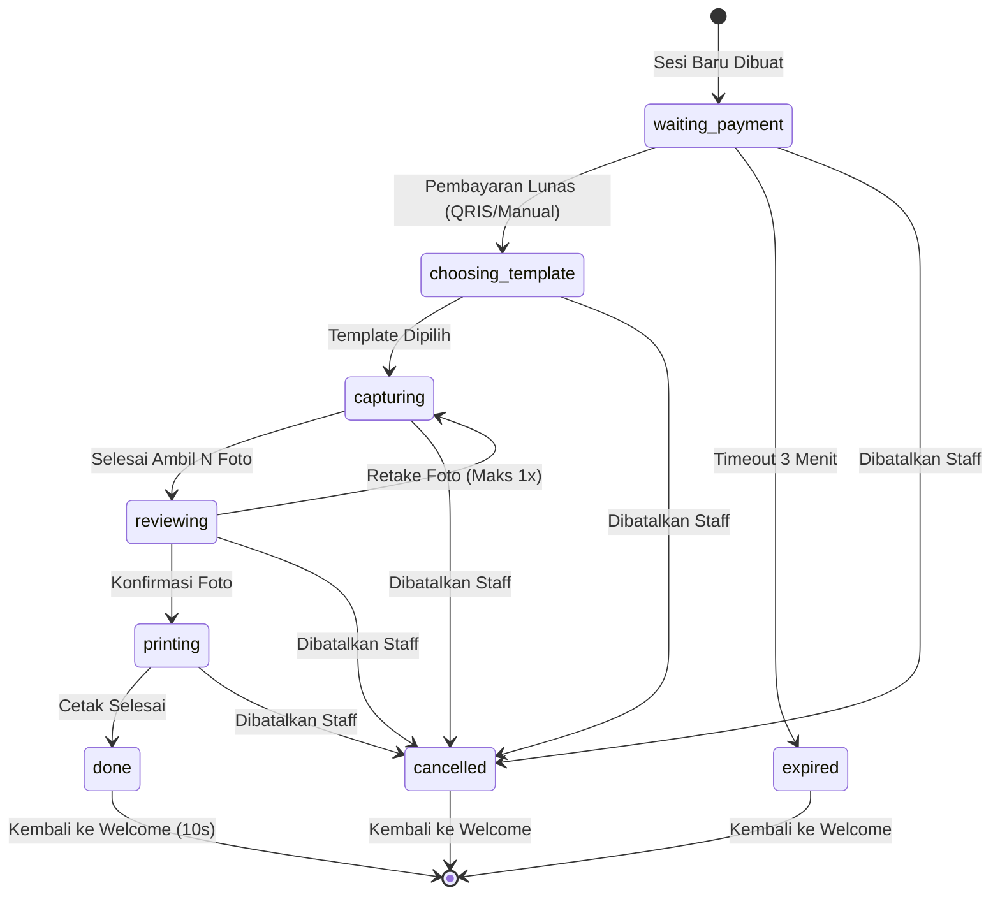

# Dokumentasi Arsitektur, Dependensi, dan Codebase — Teras Photobooth

Dokumen ini menjelaskan secara menyeluruh struktur direktori, dependensi proyek, dan implementasi teknis codebase yang telah disiapkan untuk **Teras Photobooth** berdasarkan spesifikasi [PRD.md](file:///d:/teras-photobooth/docs/PRD.md) dan panduan teknis [GEMINI.md](file:///d:/teras-photobooth/GEMINI.md).

---

## 1. Ringkasan Arsitektur Sistem

Aplikasi ini mengusung arsitektur **Local-First Hybrid Web App** yang dapat dijalankan dalam dua lingkungan:
1. **Desktop Mode (Electron)**: Membuka dua jendela terpisah secara otomatis (Admin di layar laptop staff dan Kiosk *fullscreen* di monitor kedua untuk customer), menjalankan backend in-process, dan menangani pencetakan senyap (*silent print*) lewat IPC Electron.
2. **Web Development Mode (Browser)**: Menjalankan Express backend di `localhost:3000` dan Vite dev server di `localhost:5173` secara bersamaan, sehingga seluruh fitur UI, logika kamera (`getUserMedia`), komposit Canvas, dan alur transaksi dapat dikembangkan dan diuji langsung melalui browser (Chrome/Edge).



---

## 2. Struktur Folder Proyek

```
teras-photobooth/
├── .env                       # Variabel lingkungan lokal (tidak di-commit ke Git)
├── .env.example               # Template konfigurasi environment
├── .gitignore                 # Daftar file/folder yang diabaikan oleh Git
├── index.html                 # Halaman navigasi awal saat pengujian mode web
├── package.json               # Konfigurasi proyek, scripts, dan daftar dependensi
├── vite.config.js             # Konfigurasi bundler Vite (multi-page + Tailwind plugin)
│
├── docs/                      # Dokumentasi resmi proyek
│   ├── PRD.md                 # Product Requirements Document (sumber kebenaran MVP)
│   ├── DESIGN.md              # Spesifikasi desain dan tata letak
│   └── CODEBASE.md            # Laporan teknis arsitektur dan codebase (dokumen ini)
│
├── electron/                  # Lapisan desktop Electron
│   ├── main.js                # Entry point utama Electron (multi-window, server lifecycle, IPC)
│   └── preload.js             # Bridge komunikasi aman (Context Isolation) ke renderer
│
├── server/                    # Backend lokal (Node.js + Express)
│   ├── index.js               # Inisialisasi Express server, middleware, dan mounting rute
│   ├── db.js                  # Setup koneksi database SQLite (better-sqlite3) & migrasi skema
│   ├── events.js              # Manajer Server-Sent Events (SSE) untuk sinkronisasi real-time
│   └── routes/                # Endpoint modular REST API
│       ├── health.js          # (via inline server/index.js) Pemeriksaan kesehatan server
│       ├── settings.js        # Konfigurasi operasional (harga sesi, jumlah cetak, PIN)
│       ├── templates.js       # Galeri dan data metadata template
│       ├── sessions.js        # Siklus hidup sesi photobooth dan validasi state
│       └── payments.js        # Integrasi pembayaran QRIS dan verifikasi manual staff
│
├── src/                       # Frontend antarmuka pengguna
│   ├── styles.css             # Import Tailwind CSS v4 & definisi tema warna/font
│   ├── shared/                # Modul logika bersama (reusable & pure logic)
│   │   ├── constants.js       # Konstanta global (status sesi, ukuran kanvas 4R, batas waktu)
│   │   ├── session-state.js   # Pure state machine transisi status sesi photobooth
│   │   └── api.js             # Klien fetch API ke backend + polyfill browser untuk print
│   ├── kiosk/                 # Antarmuka Layar Pelanggan (Monitor 2)
│   │   ├── index.html         # Dokumen HTML kiosk dengan CSP ketat
│   │   ├── main.js            # Entry point script kiosk & manajemen render layar
│   │   └── screens/           # Komponen layar modular (pola mount/unmount)
│   │       └── welcome.js     # Layar awal sambutan ("Sentuh/Klik untuk Mulai")
│   └── admin/                 # Antarmuka Layar Staff / Operator (Laptop)
│       ├── index.html         # Dokumen HTML panel admin dengan CSP ketat
│       └── main.js            # Panel kendali perangkat, form pengaturan, dan reset darurat
│
├── data/                      # Folder data lokal (runtime storage)
│   ├── photobooth.db          # Database file SQLite (dibuat otomatis saat runtime)
│   └── photos/                # Direktori penyimpanan file foto mentah dan komposit cetak
│
├── templates/                 # Direktori penyimpanan file template cetakan (PNG + JSON)
└── tests/                     # Unit testing (Vitest)
    └── session-state.test.js  # Pengujian otomatis logika transisi state machine sesi
```

---

## 3. Penjelasan Dependensi

Sesuai filosofi **KISS (Keep It Simple, Stupid)** dan **YAGNI (You Aren't Gonna Need It)** pada PRD:
- **Tanpa framework UI (No React/Vue/Svelte):** Menghindari overhead bundle, kompilasi rumit, dan re-render cycle yang tidak perlu untuk kiosk photobooth berbasis state statis.
- **Tanpa ORM (No Prisma/Sequelize):** Menggunakan query SQL langsung yang transparan, mudah di-audit, dan cepat.
- **Tanpa library state management eksternal (No Redux/Zustand):** State sesi tersimpan di server/database SQLite, UI merender dari state tersebut dan tahan banting jika browser/aplikasi di-restart mendadak.

### 3.1. Production Dependencies (`dependencies`)

| Paket | Versi | Alasan & Kegunaan |
| :--- | :--- | :--- |
| **`express`** | `^5.3.0` | Framework HTTP server lokal yang ringan untuk menyediakan API rute (`/api/*`), menyajikan berkas template statis, serta streaming Server-Sent Events (`/events`). |
| **`better-sqlite3`** | `^13.0.3` | Driver SQLite paling cepat dan stabil untuk Node.js. Berjalan sinkron (tanpa event loop lag), bebas ketergantungan server terpisah, dan mendukung WAL mode. |
| **`cors`** | `^2.8.6` | Mengizinkan permintaan lintas domain saat Vite dev server (`port 5173`) mengakses Express API (`port 3000`). |
| **`dotenv`** | `^18.0.7` | Membaca konfigurasi sensitif (API Key payment gateway, port, admin PIN) dari file lokal `.env` ke `process.env`. |

### 3.2. Development Dependencies (`devDependencies`)

| Paket | Versi | Alasan & Kegunaan |
| :--- | :--- | :--- |
| **`vite`** | `^8.3.4` | Bundler generasi baru dengan Instant Server Start dan Hot Module Replacement (HMR) secepat kilat untuk HTML/JS vanilla. Mendukung build multi-page untuk kiosk dan admin. |
| **`@tailwindcss/vite`** | `^4.3.3` | Plugin resmi Tailwind CSS v4 untuk integrasi native langsung di dalam proses build Vite tanpa perlu CLI terpisah. |
| **`tailwindcss`** | `^4.3.3` | Framework utility CSS untuk styling responsif antarmuka pengguna tanpa menulis CSS custom berulang. |
| **`electron`** | `^44.7.0` | Runtime desktop yang menggabungkan Chromium dan Node.js untuk target distribusi installer di laptop staff. |
| **`@electron/rebuild`** | `^4.2.1` | Perkakas untuk memastikan modul native C++ (`better-sqlite3`) terkompilasi sesuai versi ABI Electron saat packaging. |
| **`vitest`** | `^5.0.3` | Test runner modern berkecepatan tinggi yang kompatibel dengan konfigurasi Vite untuk menguji logika murni (*pure logic*). |
| **`concurrently`** | `^10.0.6` | Menjalankan backend server dan frontend dev server secara paralel dalam satu perintah terminal (`npm run dev`). |
| **`cross-env`** | `^10.1.0` | Memastikan pengaturan variabel lingkungan (seperti `NODE_ENV=production`) berjalan konsisten di Windows, macOS, maupun Linux. |

---

## 4. Penjelasan Mendalam Modul Codebase

### 4.1. Lapisan Desktop (`electron/`)

#### [`electron/main.js`](file:///d:/teras-photobooth/electron/main.js)
- **Peran:** Mengelola siklus hidup aplikasi desktop.
- **Fitur Utama:**
  1. **Server In-Process:** Memanggil fungsi `startServer()` dari backend Express saat Electron siap (`app.whenReady()`).
  2. **Multi-Window:** Mendeteksi monitor eksternal melalui `screen.getAllDisplays()`. Jendela **Admin** diletakkan di layar utama (laptop), sedangkan jendela **Kiosk** otomatis dibuka dalam mode *fullscreen* di monitor kedua (jika terdeteksi).
  3. **Keamanan Ketat:** Mengaktifkan `contextIsolation: true`, mematikan `nodeIntegration: false`, dan mengaktifkan `sandbox: true`.
  4. **Silent Printing:** Menyediakan handler IPC `printer:print-silent` via `webContents.print({ silent: true, printBackground: true })` sehingga pencetakan lembar 4R berjalan otomatis tanpa menampilkan dialog Windows/macOS.

#### [`electron/preload.js`](file:///d:/teras-photobooth/electron/preload.js)
- **Peran:** Jembatan API aman (*safe bridge*) antara proses Node.js utama dan renderer browser.
- **Fitur Utama:** Mengekspos objek `window.photobooth` yang berisi method aman:
  - `getAppVersion()`: Mendapatkan versi aplikasi.
  - `printSilent(options)`: Mengirim instruksi cetak senyap ke printer default.
  - `quitApp()`: Keluar dari aplikasi.

---

### 4.2. Lapisan Backend & Database (`server/`)

#### [`server/db.js`](file:///d:/teras-photobooth/server/db.js)
- **Peran:** Inisialisasi dan koneksi SQLite lokal.
- **Skema Database:**
  - `templates`: `id`, `nama`, `file_png`, `jumlah_slot`, `aktif`, `slots_json`.
  - `sessions`: `id`, `template_id`, `status`, `dibuat_pada`.
  - `payments`: `id`, `session_id`, `order_id`, `nominal`, `status`, `qris_string`, `dibayar_pada`.
  - `photos`: `id`, `session_id`, `urutan`, `path_file`.
  - `settings`: Pasangan `key` dan `value` (harga sesi, jumlah cetak default, admin PIN, folder output).
- **Fitur Penting:**
  - Mengaktifkan `PRAGMA journal_mode = WAL` (Write-Ahead Logging) untuk menjamin persistensi tinggi dan eksekusi non-blocking.
  - Seeding otomatis nilai *default* ke tabel `settings` jika data belum ada.

#### [`server/events.js`](file:///d:/teras-photobooth/server/events.js)
- **Peran:** Real-time event broker menggunakan **Server-Sent Events (SSE)**.
- **Mengapa SSE bukan WebSocket?** Sesuai PRD, komunikasi real-time ini hanya bersifat satu arah dari server ke klien (push notifikasi status pembayaran dan transisi sesi). SSE berbasis HTTP biasa, bebas kompleksitas handshake, dan otomatis melakukan reconnect bawaan browser.
- **Fungsi:** `broadcastEvent(eventName, data)` menyiarkan pembaruan sesi ke seluruh monitor yang terhubung.

#### [`server/index.js`](file:///d:/teras-photobooth/server/index.js)
- **Peran:** Entry point server HTTP Express.
- **Endpoint Utama:**
  - `GET /api/health`: Healthcheck status server.
  - `GET /events`: Koneksi stream SSE.
  - `/templates`: Melayani file gambar statis overlay template.
  - `/api/settings`: Baca dan perbarui parameter operasional photobooth.
  - `/api/templates`: Ambil galeri template aktif.
  - `/api/sessions`: Buat sesi baru, cek sesi aktif, dan transisi state machine.
  - `/api/payments`: Ambil status QRIS dan tombol cadangan konfirmasi manual oleh staff (F-04).

---

### 4.3. Lapisan Frontend (`src/`)

#### Pola Desain Layar Modular (`mount()` / `unmount()`)
Sesuai aturan di [GEMINI.md](file:///d:/teras-photobooth/GEMINI.md), setiap layar antarmuka diimplementasikan sebagai modul mandiri dengan dua fungsi:
- `mount(parent)`: Membuat elemen DOM, menyisipkan ke parent, dan memasang event listener.
- `unmount()`: Membersihkan timer/interval, menghentikan stream webcam, melepas event listener, dan menghapus elemen dari DOM untuk mencegah *memory leak*.

#### [`src/kiosk/`](file:///d:/teras-photobooth/src/kiosk/)
- **Index HTML:** Memuat stylesheet Tailwind dan script module dengan Content Security Policy (CSP) ketat.
- **Screen `welcome.js`:** Tampilan awal selamat datang dengan tombol sentuh berukuran besar (tinggi 80px / min-height 64px, ramah sentuhan) bertuliskan *"Sentuh atau Klik untuk Mulai"*. Saat diklik, mengirim panggilan ke API untuk membuat sesi baru berstatus `waiting_payment`.

#### [`src/admin/`](file:///d:/teras-photobooth/src/admin/)
- **Panel Indikator Perangkat:** Memantau status perangkat secara visual (Kamera Eksternal, Printer Default, Koneksi Internet, Sinkronisasi Google Drive).
- **Form Pengaturan:** Input harga sesi per orang (Rp) dan jumlah cetak per sesi yang langsung tersimpan ke SQLite.
- **Tombol Darurat (Reset Sesi):** Menangani kendala lapangan jika customer membatalkan sesi di tengah jalan.

#### [`src/styles.css`](file:///d:/teras-photobooth/src/styles.css)
Menggunakan fitur baru **Tailwind CSS v4** dengan direktif `@theme`:
- `--color-primary`: `#FF4D6D` (Merah muda cerah khas photobooth)
- `--color-dark`: `#1F1B2E` (Ungu gelap pekat untuk teks & kontras tajam)
- `--color-background`: `#FFF8F3` (Krem lembut ramah mata)
- `--color-accent`: `#FFD166` (Kuning aksen)
- `--color-success`: `#2BB673` (Hijau status sukses)
- `--color-error`: `#E5484D` (Merah error/batal)
- `--font-sans`: `'Plus Jakarta Sans', system-ui, sans-serif`

---

### 4.4. Lapisan Logika Bersama (`src/shared/`)

#### [`src/shared/constants.js`](file:///d:/teras-photobooth/src/shared/constants.js)
Menyimpan semua konstanta terpusat agar tidak ada *magic numbers* atau *magic strings*:
- `SESSION_STATES`: Enum status sesi (`waiting_payment`, `choosing_template`, `capturing`, `reviewing`, `printing`, `done`, `cancelled`, `expired`).
- `CANVAS_SPECS`: Spesifikasi kanvas 1200×1800 px pada 300 DPI (format cetak standar 4R).
- `TIMEOUTS`: Batas waktu pembayaran QRIS (180 detik / 3 menit), interval polling gateway (2.5 detik), hitung mundur foto (3 detik).
- `DEFAULTS`: Nilai bawaan harga sesi (Rp 25.000), 1 lembar cetak, PIN admin `1234`.

#### [`src/shared/session-state.js`](file:///d:/teras-photobooth/src/shared/session-state.js)
- **Peran:** *Pure state machine* yang mengatur alur hidup sesi secara kaku dan teruji.
- **Fungsi:** `isValidTransition(current, target)` dan `transitionSessionState(current, target)`.
- Menolak lompatan status ilegal (misalnya dari `waiting_payment` langsung ke `printing` akan melempar *exception*).

#### [`src/shared/api.js`](file:///d:/teras-photobooth/src/shared/api.js)
- Wrapper fungsi fetch standar untuk memanggil REST endpoint server Express.
- Memiliki fitur **Browser Polyfill Graceful Fallback**: Jika aplikasi dibuka di browser biasa tanpa Electron, `window.photobooth.printSilent()` akan otomatis memanggil fungsi native `window.print()` browser sehingga proses cetak tetap bisa diuji tanpa error `undefined`.

---

## 5. Alur State Machine Sesi Photobooth



---

## 6. Pengujian & Verifikasi Kualitas

Pengujian otomatis dibangun menggunakan **Vitest** pada file [`tests/session-state.test.js`](file:///d:/teras-photobooth/tests/session-state.test.js):
- Memverifikasi transisi maju yang valid (`waiting_payment` → `choosing_template` → `capturing` → `reviewing` → `printing` → `done`).
- Memverifikasi alur retake dari `reviewing` kembali ke `capturing`.
- Memverifikasi penanganan pembatalan (*cancellation*) dari setiap status aktif.
- Memverifikasi penolakan transisi ilegal (*invalid transition rejection*).

Untuk menjalankan test suite kapan saja:
```powershell
npm run test
```

---

## 7. Panduan Perintah Pengembangan

| Perintah | Deskripsi |
| :--- | :--- |
| `npm run dev` | Menjalankan Vite dev server (`:5173`) dan Express backend (`:3000`) secara bersamaan untuk pengujian di browser. |
| `npm run dev:vite` | Menjalankan hanya Vite dev server. |
| `npm run dev:server` | Menjalankan hanya backend Express lokal. |
| `npm run dev:electron`| Menjalankan Vite dan membuka jendela desktop Electron (khusus environment yang mendukung eksekusi Electron). |
| `npm run build` | Melakukan kompilasi bundle produksi frontend multi-page ke dalam folder `dist/`. |
| `npm run test` | Menjalankan seluruh unit test dengan Vitest. |
